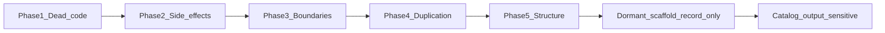

# Code smells remediation — Implementation Plan

> **No commit steps.** CLAUDE.md forbids `git commit`/`push`/PR without explicit
> permission for that action. Each phase ends at green checks and stages nothing.

**Source:** full code-smell review of `src/app` and `tests/` (40 findings,
numbered #1–#40; the numbering is kept so findings can be cross-referenced).

**No spec.** Every item fixed here is a behaviour-preserving refactor, which
CLAUDE.md lets go without one. The output-sensitive items at the end change
behaviour if they are ever fixed, so each needs its own spec in `docs/specs/`
first; this plan does not fix them.

**Goal:** remove the smells in code that runs today without changing any stored
output; record the dormant and output-sensitive ones with the condition that
would make them worth acting on.

## Global constraints

- **Stored outputs stay byte-for-byte identical.** `panel_long.parquet`,
  `macro_q.parquet`, the `features_*` parquets and the notebook tables must not
  change. No item in Phases 1–5 may require a notebook rerun to stay valid.
- mypy strict; `uv run poe check` green at the end of every phase.
- No `# noqa`, `# ruff: ignore`, `# type: ignore`, `# pyright: ignore`.
- Existing tests are the safety net: a refactor may rename what they call,
  never change what they expect. Test count may only grow.
- **Characterization first.** Before a refactor touches a computation, add a
  pytest that pins its current output on the existing fixtures (`make_panel`,
  the VCR cassettes). The refactor keeps that test green.
- If a characterization test shows that two sites meant to be merged disagree
  today, the merge stops and the item moves to the output-sensitive catalog.

### Notebook rerun marker

Every item carries one of:

| Marker | Meaning |
|---|---|
| **No** | No stored output changes. |
| **Optional** | Only figure text or presentation could change; rerun only to refresh saved figures. |
| **Only after re-ingestion** | Affects the next ingestion CLI run. NB00 reads the panels already on disk, so notebooks are unaffected until someone re-ingests. |

### Which findings count as smells today

A finding is acted on now only if its code runs in something used today: the
ingestion CLI, the notebooks, or the services they call. Code reached only by
the template API and Streamlit pages (and their own tests) is **dormant
scaffold**: it is not development yet, so its smells are recorded with a trigger
and left alone.

Caveat: `.github/workflows/deploy.yml` still deploys `master` to Render after a
green "Lint and Test" run. If that deployment is ever used, the dormant items
become live, starting with `POST /prediction/train`, which overwrites
`model.joblib`.

## Order

Cheap, isolated deletions go first so later phases touch less code. Side effects
come before structure because the structural moves (#5, #7) are easier to pin
with characterization tests once path access no longer writes to disk.

Each item lists: **Smell**, **Where**, **Cost**, **Fix**, **Tests**, **Rerun**.

## Phase 1: Dead code in live layers

### #33 Dead code (data layer only)
- **Smell:** Dead Code.
- **Where:** `PanelRow` (`src/app/data/schema.py:160`), the `CompanyMetadata`
  alias (`schema.py:12`), the unused `market_columns`, `macro_columns` and
  `series_by_column` properties.
- **Cost:** every schema change has to keep code nobody reads in step (#7).
- **Fix:** `rg` each name across `src/`, `tests/` and the notebooks; delete only
  names with no caller. The template parts of #33 are in the dormant section.
- **Tests:** none new; the suite must stay green.
- **Rerun:** No.

### #34 Settings classes with one ineffective option
- **Smell:** Speculative Generality.
- **Where:** `src/app/services/diagnostics/models.py` — `CorrelationSettings`
  (`method` accepts only `"spearman"`), `AuditSettings` (only `seed`).
- **Cost:** a model, a provider and a constructor parameter for a value that
  cannot vary.
- **Fix:** inline `CorrelationSettings.method` as a module constant in the
  correlator; pass `AuditSettings.seed` as a direct constructor argument. Keep
  `ProfileSettings`: its single boolean is a documented report-size tradeoff.
- **Tests:** existing correlator and audit tests; assert the seed still reaches
  the Isolation Forest.
- **Rerun:** No.

### #39 Error message uses notebook numbering
- **Smell:** Uncommunicative Name.
- **Where:** `src/app/data/panel_store.py:123` — `"NB00 outputs missing: ..."`.
- **Cost:** an operator has to know the notebook numbering to fix the error.
- **Fix:** name the files: `"panel_long.parquet and macro_q.parquet are required; missing: ..."`.
  Update the docstring at `:108` and `:114` to match.
- **Tests:** update the `match=` in the existing `PanelNotFoundError` test.
- **Rerun:** No.

### #38 Magic quarter length
- **Smell:** Magic Number.
- **Where:** `src/app/data/xbrl.py:297` — `abs(duration - 91)`, beside the
  named `MIN_QUARTER_DAYS`/`MAX_QUARTER_DAYS` (`:36-37`).
- **Cost:** the tie-break rule is unreadable next to its named neighbours.
- **Fix:** `TYPICAL_QUARTER_DAYS: Final = 91` beside the other two.
- **Tests:** none new.
- **Rerun:** No.

## Phase 2: Side effects and hidden dependencies

### #2 Import-time bootstrap — already resolved
- **Status:** fixed before this plan ran, in commit `5c689f7`
  ("remove unused bootstrap import and file"). `src/app/__init__.py` holds only
  `__version__`; `create_app()`, the three ingestion CLIs (`runner`, `batch`,
  `coverage_runner`), `tests/conftest.py`, `tests/api/conftest.py` and the
  notebooks call `configure_container()` explicitly. The Streamlit pages use no
  container. No change made.

### #3 Path getters create directories
- **Smell:** Side Effect.
- **Where:** `src/app/settings.py:86-89` (`DATA_DIRECTORY`) and `:111-114`
  (`panel_output_path`).
- **Cost:** reading a path writes to disk, so a typo in a test or notebook
  silently creates directories.
- **Fix:** make both pure. Every live writer already creates its own parent:
  `write_panel` (`pipeline.py:192`), the batch ledger (`batch.py:59`), the
  coverage report (`coverage_runner.py:51`), `FeatureStore.write`
  (`feature_store.py:31`), the Alpha Vantage cache (`alpha_vantage/source.py:117`)
  and `ReportStore` (#22). `MODEL_DIRECTORY` (`:37-41`) keeps its `mkdir`
  because only the template's `save_model` depends on it; it is in the dormant
  section.
- **Tests:** reading `Settings.DATA_DIRECTORY` with `ROOT_PATH` pointed at
  `tmp_path` creates nothing; ingestion into an empty `tmp_path` still writes
  the panel.
- **Rerun:** No.

### #22 Store contracts are inconsistent
- **Smell:** Oddball Solution, Side Effect.
- **Where:** `src/app/data/report_store.py:24` (`path_for` creates the
  directory), `feature_store.py` (`read` lets `FileNotFoundError` escape),
  `panel_store.py` (translates a missing file into `PanelNotFoundError`).
- **Cost:** three stores, three answers to "what happens when the artifact is
  missing".
- **Fix:** `path_for` is pure in every store; every store write method creates
  the directory. Notebooks that hand a `path_for` path to ydata-profiling get a
  `ReportStore` write method for HTML so the directory is still created.
  `FeatureStore.read` raises a typed artifact error for a missing file, matching
  `PanelStore`.
- **Tests:** `path_for` on a missing directory creates nothing; `FeatureStore.read`
  on a missing file raises the typed error.
- **Rerun:** No.

### #27 Hidden source dependencies
- **Smell:** Hidden Dependency.
- **Where:** `Settings.REQUEST_TIMEOUT` read inside
  `sec_edgar/source.py:426`, `alpha_vantage/source.py:143` and
  `data/add_company.py:41`; the FRED source builds its own client and exposes
  `**kwargs`.
- **Cost:** tests cannot vary the timeout or substitute the FRED client without
  patching globals.
- **Fix:** constructor parameters `timeout: int` and (FRED) `client`, supplied by
  `injections/production.py`. `timeout` is required, not defaulted, so the
  30 seconds lives only in `Settings.REQUEST_TIMEOUT`. FRED's `**kwargs` became
  an explicit `units` keyword. `add_company.lookup_ticker` takes `user_agent`
  and `timeout` from its CLI command. The coverage runner builds its Alpha
  Vantage source from the container, which also settles #13's duplicated cache
  path.
- **Tests:** a source constructed with an explicit timeout passes it to
  `requests.get` (assert on the mock call).
- **Rerun:** No.
- **Status:** done.

## Phase 3: Error boundaries

These change only what happens on an error path during ingestion. Panels already
on disk are unaffected.

### #6 SEC exceptions form an inconsistent boundary
- **Smell:** Exception as Control Flow, Dead Handler.
- **Where:** `src/app/data/sources/sec_edgar/source.py:181-188`, `:419-437`
  (the `except DataSourceUnavailableError: raise` at `:430` is dead);
  `sec_edgar/parsing.py:22-39`.
- **Cost:** a 404 is interpreted by catching a leaked `requests.HTTPError`; the
  same exception from other SEC URLs escapes the data layer; a malformed parent
  object raises `AttributeError` and aborts a batch.
- **Fix:** `_get_json` checks the status code itself and returns a "not found"
  result for 404 before calling `raise_for_status`; delete the dead `except`;
  validate each parent level in `concept_facts` and raise
  `MalformedPayloadError`.
- **Tests:** 404 → company skipped with a warning; 500 → `DataSourceUnavailableError`;
  a non-dict `units` → `MalformedPayloadError`. Existing cassettes stay green.
- **Rerun:** Only after re-ingestion.
- **Status:** done. `_get_json` returns `None` for 404 and wraps every other
  HTTP, network or JSON-decode failure in `DataSourceUnavailableError` naming
  the URL. A companyfacts 404 still yields empty facts (the existing behaviour);
  a 404 on the ticker file is `DataSourceUnavailableError`; a non-object body
  or ticker entry is `MalformedPayloadError`.

### #12 Same SEC ticker lookup exists twice
- **Smell:** Duplicate Code.
- **Where:** `src/app/data/add_company.py`, `sec_edgar/source.py`,
  `data/companies.py`.
- **Cost:** URL, request, parsing, CIK padding and validation are copied; their
  malformed-payload behaviour differs.
- **Fix:** one SEC ticker client inside the `sec_edgar` package, used by
  `add_company` and `SecEdgarSource`, applying `_validate_cik` to every CIK.
  Re-export it from `sec_edgar/__init__.py`.
- **Tests:** one test per malformed-payload case against the shared client; the
  `add_company` cassette stays green.
- **Rerun:** Only after re-ingestion.
- **Status:** done. `sec_edgar.parsing.sec_tickers` validates the file and
  every entry (CIK checked by the registry's `is_valid_cik`);
  `sec_edgar.source.fetch_sec_tickers` fetches it through the same HTTP
  boundary as companyfacts. `SecEdgarSource` and `add_company` both use it, and
  `add_company` reports a `DataSourceError` as a CLI error. `add_company` had no
  cassette; its tests stub `fetch_sec_tickers`. A duplicated ticker in SEC's
  file resolves to the last entry, which is what ingestion already did
  (`add_company` used to take the first).

### #24 Coverage loop uses exceptions to continue
- **Smell:** Exception as Control Flow (CLAUDE.md error-handling rule).
- **Where:** `src/app/data/coverage_runner.py` catches `DataSourceError` inside
  the per-ticker loop; `data/batch.py` already returns an `IngestOutcome`.
- **Cost:** two patterns for the same "one ticker failed" case.
- **Fix:** `_probe_ticker` returns a typed outcome; the loop logs a warning and
  continues on the outcome, not on an exception.
- **Tests:** a failing ticker appears in the report as failed and the run
  continues.
- **Rerun:** Only after re-ingestion (the coverage report only).
- **Status:** done. `_probe_ticker` catches `DataSourceError` at the per-ticker
  boundary, logs a warning, and returns the report entry itself (the JSON dict
  already written to the report), so the loop only appends and echoes. The
  computation moved to `_coverage_report`, which the tests now stub so the real
  catch runs. Console lines and the JSON report are unchanged; the existing
  tests asserted both and pass with no assertion changes.

## Phase 4: Duplication that is the same rule

### #13 Core data rules are duplicated
- **Smell:** Duplicate Code / Oddball Solution.
- **Where:** `MILLIONS_DIVISOR` (`schema.py`, `pipeline.py:22`); XBRL start date
  (`pipeline.py`, `coverage.py`, tests); 20-year default range (`pipeline.py`,
  `coverage_runner.py`); margin calculation (SEC and Alpha Vantage parsing);
  company value columns (`schema.py`, `missing.py`); pre-listing cutoff
  (`flags.py`, `missing.py`). The Alpha Vantage cache path pair was settled by
  #27.
- **Cost:** changing one business rule leaves its twin behind.
- **Fix:** one constant or function per rule, in the module that owns the rule
  (`app/data/` for shared rules; vendor-specific ones stay in their package).
  Merge each pair only after a characterization test shows both sites agree.
- **Tests:** one characterization test per pair, kept after the merge.
- **Rerun:** No (any disagreement found moves that pair to the catalog).

### #14 Robust-z calculation is duplicated
- **Smell:** Duplicate Code.
- **Where:** `src/app/services/diagnostics/audit.py:129-178` (`_scores` and
  `_target_extremes`).
- **Fix:** one `_robust_z(series) -> pd.Series` used by both; Hampel logic stays
  separate.
- **Tests:** characterization of both callers on `make_panel` before the change.
- **Rerun:** No.

### #15 Revenue-vs-signed target policy is scattered
- **Smell:** Shotgun Surgery.
- **Where:** `arms_for`, `default_arm`, `target_growth`
  (`services/features/transforms.py`); `candidates_for`, `baseline_transform`
  (`services/diagnostics/transform_comparison.py`).
- **Fix:** one policy record per `TargetVariable` family (allowed arms, default
  arm, growth function, baseline transform) that all five read.
- **Tests:** parametrized test over every `TargetVariable` pinning today's
  answers from each function.
- **Rerun:** No.

### #16 Column-family classification is duplicated
- **Smell:** Duplicate Code.
- **Where:** `services/diagnostics/audit.py:118-127`,
  `services/diagnostics/correlation.py:18-27`.
- **Fix:** one classifier (positive / ratio / signed) with the lag (QoQ vs YoY)
  as a parameter. The different lags are intentional and stay.
- **Tests:** characterization of both change computations.
- **Rerun:** No.

### #19 Boxplot workaround copied three times
- **Smell:** Duplicate Code, Incomplete Library Class.
- **Where:** `src/app/services/diagnostics/figures.py`.
- **Fix:** one private boxplot adapter used by the three figures.
- **Tests:** existing figure tests (axes, labels, artist counts).
- **Rerun:** No.

### #20 Target forward and inverse dispatch are parallel
- **Smell:** Duplicate Conditional Logic.
- **Where:** `TargetTransformer.make()` and `reconstruct()` in
  `services/features/transforms.py`.
- **Fix:** each `TargetArm` maps to one pair of forward/inverse functions; both
  methods look up the pair.
- **Tests:** round-trip test per arm (`reconstruct(make(x)) == x`) plus
  characterization of `make` output.
- **Rerun:** No.

### #21 DI reconstructs identical settings
- **Smell:** Duplicate Construction.
- **Where:** `src/app/injections/production.py:104-146` — `OutlierSettings()`
  built three times, `DiagnosticsSettings()` twice.
- **Fix:** one `Singleton` provider per settings model, injected everywhere.
- **Tests:** the providers that consume `OutlierSettings` receive the same
  instance.
- **Rerun:** No.

### #31 Notebook bootstrap is duplicated
- **Smell:** Duplicate Code.
- **Where:** first cells of `00_ingest_and_consolidate.ipynb`,
  `01_eda_feature_engineering.ipynb`, `01b_transform_comparison.ipynb`.
- **Fix:** a shared target-variable list constant in the features package that
  the notebooks import. Only code cells are edited; outputs stay valid, and no
  notebook is executed.
- **Tests:** a test that the constant equals today's notebook list.
- **Rerun:** No.

### #35 Transform-family tuple is positional
- **Smell:** Data Clump.
- **Where:** `services/diagnostics/transform_comparison.py:113-123`
  (`(own_transform, sector_transform, estimator)`).
- **Fix:** a frozen `NamedTuple` with those three field names.
- **Tests:** existing transform-comparison tests.
- **Rerun:** No.

### #36 Quantile-pair validation is duplicated
- **Smell:** Duplicate Code.
- **Where:** `FigureSettings` and `SegmentSettings` in
  `services/diagnostics/models.py`.
- **Fix:** one `Annotated` quantile-pair type with an `AfterValidator` enforcing
  `0 <= lower < upper <= 1`.
- **Tests:** existing validator tests run against both models.
- **Rerun:** No.

### #37 Quarter-end rules have several implementations
- **Smell:** Oddball Solution.
- **Where:** `data/dates.py`, `data/pipeline.py`, `data/companies.py`,
  `data/structural_breaks.py`.
- **Fix:** one quarter-end predicate and one "latest completed quarter" function
  in `src/app/data/dates.py`; the other three call them.
- **Tests:** before switching, a test that the old and new implementations agree
  for every day from 2006-01-01 to 2026-12-31.
- **Rerun:** No.

### #40 Repeated SEC test fixtures
- **Smell:** Duplicate Test Code.
- **Where:** `tests/data/sources/test_sec_edgar.py`, `test_sec_edgar_shares.py`,
  `test_sec_edgar_company_facts.py`, `tests/data/test_pipeline.py`.
- **Fix:** user-agent constant, source construction and fact builders move to
  `tests/data/conftest.py`. Keep the secret scan clean: fixtures use the
  placeholder user agent, never the `.env` value.
- **Tests:** test count unchanged; cassettes untouched.
- **Rerun:** No.

## Phase 5: Structure

### #5 SecEdgarSource has too many reasons to change
- **Smell:** Divergent Change.
- **Where:** `src/app/data/sources/sec_edgar/source.py:143-438`.
- **Cost:** an HTTP-policy change and an accounting-rule change edit the same
  class.
- **Fix:** keep transport and caching in `source.py`; move tag-chain precedence,
  quarterly derivation and share-count recovery into pure functions beside
  `parsing.py`. Import direction stays `source.py → parsing.py`.
- **Tests:** before the move, pin the full panel frame produced from each SEC
  cassette; the frames must be identical afterwards.
- **Rerun:** No.

### #7 Financial schema requires shotgun edits
- **Smell:** Shotgun Surgery.
- **Where:** `src/app/data/schema.py:39-207`, SEC and Alpha Vantage frame
  construction, `tests/data/test_schema.py`.
- **Fix:** one authoritative financial column declaration; the column tuples,
  `FinancialQuarterValues` and `FinancialsRow` derive from it where Pydantic
  allows. Column order in written panels stays the same.
- **Tests:** written panel columns and dtypes equal today's, in order.
- **Rerun:** No.

### #10 DiagnosticsService is mostly a middle man
- **Smell:** Middle Man.
- **Where:** `src/app/services/diagnostics/service.py:49-77`.
- **Fix:** delete the pure forwarding methods; keep the panel-diagnosis
  orchestration. Notebooks call the collaborators from the container
  (`container.outlier_register()` and similar). Only code cells change; saved
  outputs stay valid.
- **Tests:** facade tests for deleted methods move to the collaborators' tests.
- **Rerun:** No.

### #18 Figure labels hardcode configurable values
- **Smell:** Fallacious Label.
- **Where:** `src/app/services/diagnostics/figures.py` ("8-quarter window",
  "1st–99th percentile", "STL, period 4").
- **Fix:** build the label text from the settings that drive the computation.
  With today's settings the strings are identical.
- **Tests:** labels equal today's strings with default settings and follow a
  changed setting.
- **Rerun:** Optional (labels change only if someone changes the settings).

### #23 PanelStore validates only part of the panel schema
- **Smell:** Incomplete Validation.
- **Where:** `src/app/data/panel_store.py:8-21` (`REQUIRED_COLUMNS` omits the
  market, derived, provenance and period-offset columns).
- **Fix:** validate against `PANEL_COLUMNS`.
- **Pre-check (read-only, before the change):** load every
  `data/processed/*_panel.parquet` on disk and confirm each contains all of
  `PANEL_COLUMNS`. If any panel fails, stop: the stricter check would break NB00,
  and the item needs a decision first.
- **Tests:** a panel missing `stock_price` raises the validation error.
- **Rerun:** No.

### #32 Committed notebook outputs obscure source
- **Smell:** Obscured Intent / Repository Bloat.
- **Where:** `01_eda_feature_engineering.ipynb`, `01b_transform_comparison.ipynb`.
- **Fix:** add an output stripper (`nbstripout`) as a pre-commit hook for future
  commits. Existing saved outputs are not cleared by this plan.
- **Tests:** `uv run poe format` runs the hook cleanly.
- **Rerun:** No.

## Dormant scaffold: recorded, not fixed

Template code that nothing in development uses. Until its trigger fires, an item
here is not worth fixing. All markers are **Rerun: No**.

| # | Smell | Where | Trigger |
|---|---|---|---|
| 1 | Template product vertical (machine age, time to failure; "FastAPI Production Template" title) | `api/app.py:8`, `api/routes/prediction/`, `api/routes/train/`, `domain/prediction_*.py`, `services/prediction/`, `services/training/` | NB09, when real `Forecast` and `Forecaster` types exist. Replace the vertical in one slice and delete the old files then. If the Render deployment is used before that, unregister `train_router` first. |
| 4 | Model loaded from disk twice per prediction | `services/prediction/service.py:17-24` | Same as #1; it disappears with the template service. |
| 29 | Train schema raises a service exception | `api/routes/train/schemas.py` | Same as #1. |
| 30 | Services modelled as Pydantic `BaseModel` | `services/prediction/service.py`, `services/training/service.py` | Same as #1. The NB09 forecasting service is written as a plain class from the start. |
| 11 | One container for API and research providers | `injections/production.py:53-147` | The first real API service at NB09. Only the research and ingestion halves are real today, so a split now is premature. |
| 33 | Template dead code: `create_examples` (`utils/exampler.py:23`), `ExamplerMixIn` on `BaseEntity`, empty `TestContainer` (`injections/test.py:4`) and its override, Streamlit test page and registry entry, health page "Prediction:" label and hardcoded URL, unused `UI_HOST`, `API_HOST`, `SOCKET_URL` | as listed | The first real Streamlit page or API route. |
| 3 (part) | `MODEL_DIRECTORY` creates its directory on read | `settings.py:37-41` | Same as #1; move the `mkdir` into the writer when the template `save_model` is replaced. |

## Output-sensitive catalog: not resolved

Fixing any of these changes stored data or notebook tables. Each needs its own
spec in `docs/specs/` (required behaviour, evidence, acceptance criteria) before
any code change. No fix is proposed here.

| # | Smell | Where | What would change | Reruns needed if changed |
|---|---|---|---|---|
| 8 | Yahoo fallback inconsistent: prices/splits fall back `GOOGL → GOOG`, dividends do not; broad `except Exception` | `yfinance_source/fetching.py:35-87`, `yfinance_source/source.py` | Market and dividend-yield columns | Re-ingest, then NB00, NB01, NB01b |
| 9 | `MacroCorrelator` uses Pearson; other diagnostics use Spearman | `diagnostics/panel.py:115`, `correlation.py:84`, `transform_comparison.py:172` | Macro sensitivity tables and heatmap | NB01 |
| 17 | Two YoY revenue rules: flags turn non-positive revenue into missing, features raise `NonPositiveValueError` | `data/flags.py:68`, `features/transforms.py:82` | `outlier_flag`, or feature exports | NB00 onward (flags) or NB01 (features) |
| 25 | XBRL equality tolerance scales on one operand only; a second helper uses a different symmetric tolerance | `data/xbrl_facts.py:149-162`, `data/xbrl.py:207` | Which SEC fact wins near the threshold | Re-ingest, then NB00 onward |
| 26 | Invalid report dates: SEC logs and skips, Alpha Vantage raises `MalformedPayloadError` | `data/xbrl.py:409-422`, `alpha_vantage/parsing.py` | Which rows survive ingestion | Re-ingest, then NB00 onward |
| 28 | Deterministic flags and the fitted Isolation Forest share `flags.py` | `data/flags.py` | Moving the code alone is safe; it is listed because whether the algorithm should stay is the open question | NB00 onward, if the algorithm changes |

## Not smells

These look unusual but are justified; do not "fix" them:

- The feature-group `if` chain in `FeatureBuilder`; a strategy registry would add
  more complexity than it removes.
- `FeatureService`: unlike `DiagnosticsService` it owns pooling, arm validation,
  target construction and pre-listing behaviour.
- Config Pydantic models plus domain dataclasses in `companies.py` (CLAUDE.md
  keeps them separate on purpose).
- statsmodels/sklearn `Protocol` and `cast` declarations; third-party typing is
  incomplete.
- Lazy imports for W&B and profiling; optional research dependencies.
- `SecTickerLookup` and `MarketFromTicker` empty variants; meaningful sum-type
  cases.
- Alpha Vantage's rate-limit `continue`; it follows a parsed response, not an
  exception.
- Different QoQ versus YoY lags in audit and correlation; they answer different
  questions.
- Source-specific parsing differences that reflect real vendor semantics.
- Thin FastAPI dependency aliases in `api/dependencies.py`, and the route
  package structure.
- Early returns, and long XBRL derivation functions that each perform one
  coherent calculation.

## Verification

1. Before Phase 1, record SHA-256 hashes of `data/processed/panel_long.parquet`,
   `data/processed/macro_q.parquet` and every `data/features/*.parquet`
   (read-only).
2. `uv run poe check` green at the end of every phase.
3. After Phase 5, regenerate nothing; instead load the consolidated outputs and
   feature exports through the refactored code paths in a throwaway script
   (`PanelStore.load_consolidated`, `FeatureStore.read`) and recompute the
   features from `panel_long.parquet` into `tmp_path`. Compare hashes, or
   `pd.testing.assert_frame_equal` where parquet metadata differs, against
   step 1. Any mismatch moves the responsible change to the output-sensitive
   catalog and reverts it.
4. After Phase 2 and Phase 5, open NB00, NB01 and NB01b and confirm the edited
   code cells still import and resolve (no execution of data cells needed).
5. Secret scan before proposing a commit: `rg` `tests/data` for the real
   `SEC_USER_AGENT` email and API key values from the local `.env`; it must
   print nothing. Never write those values into this or any tracked file.
